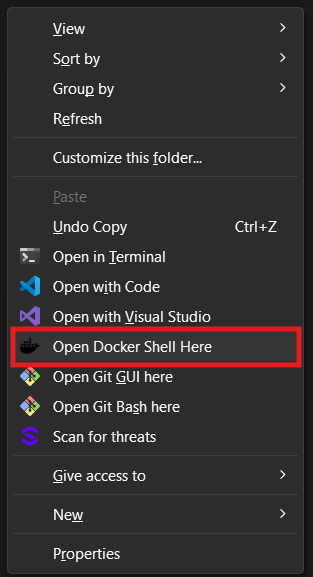

# Windows Docker Shell Context Menu

Add a context menu to windows file explorer: right click to start a docker with current directory mounted.

# Installation Steps

- Make directory `C:\Scripts` and copy `DockerShellHere.ps1` into it.
- Make sure the docker engine is running.
- Run `build.ps1` to build the docker image `kali-dev` which will be launched by the menu.
- Install registry patch `add.reg` to enable the menu.